<picture>
  <source media="(prefers-color-scheme: light)" srcset="assets/banner-light.svg">
  
</picture>

 

 

 

---

# 🇬🇧 &nbsp;English

&nbsp;

I'm a 16-year-old 10th-grade student. I contribute to projects like **NASA F´Prime** and **React**, and I try to build open-source applications. I'm interested in Linux systems, communities, and turning small ideas into working tools.

---

## `/ contributions`

> Contributions can start small. I'm trying to improve as I go.

| # | Project | Contribution | PR |
|:-:|:--|:--|:-:|
| `01` | **NASA / F´Prime** | Ensured Python 3.10 compatibility by using `timezone.utc` instead of `datetime.UTC` | [#294](https://github.com/nasa/fprime-gds/pull/294) |
| `02` | **Mozilla / MDN** | Fixed errors and technical inconsistencies in the RTT glossary entry | [#43655](https://github.com/mdn/content/pull/43655) |
| `03` | **Meta / React** | Improved the `DESIGN_GOALS` documentation and fixed typos | [#36170](https://github.com/facebook/react/pull/36170) |
| `04` | **Awesome Python** | Fixed the SQLite spelling in the database drivers section | [#3014](https://github.com/vinta/awesome-python/pull/3014) |

---

## `/ projects`

<table>
  <tr>
    <td width="60%" valign="top">
      <h3><a href="https://github.com/alideniztartma/GitCanvas">GitCanvas ↗</a></h3>
      A social art platform where every pixel is a PR. Code, color, and community meet on the same canvas.
        
      <code>pixel art</code> <code>community</code> <code>open source</code>
    </td>
    <td width="40%" valign="top">
      <h3><a href="https://github.com/alideniztartma/vessel-journal">Vessel Journal ↗</a></h3>
      A minimalist, cross-platform journaling tool.
        
      <code>journal</code> <code>cross-platform</code>
    </td>
  </tr>
</table>

---

## `/ signal`

  

<code>/</code> alideniz.me · © Ali Deniz Tartma

 

---

# 🇹🇷 &nbsp;Türkçe

&nbsp;

16 yaşında, 10. sınıf öğrencisiyim. **NASA F´Prime**, **React** gibi projelere katkı veriyorum; açık kaynak uygulamalar geliştirmeye çalışıyorum. Linux sistemleri, topluluklar ve küçük fikirleri çalışan araçlara dönüştürmekle ilgileniyorum.

---

## `/ katkılarım`

> Katkılar küçük başlayabilir. Gittikçe kendimi geliştirmeye çalışıyorum.

| # | Proje | Katkı | PR |
|:-:|:--|:--|:-:|
| `01` | **NASA / F´Prime** | `datetime.UTC` yerine `timezone.utc` kullanarak Python 3.10 uyumluluğunu sağladım | [#294](https://github.com/nasa/fprime-gds/pull/294) |
| `02` | **Mozilla / MDN** | RTT sözlüğündeki hataları ve teknik tutarsızlıkları düzelttim | [#43655](https://github.com/mdn/content/pull/43655) |
| `03` | **Meta / React** | `DESIGN_GOALS` dokümantasyonunu ve yazım hatalarını iyileştirdim | [#36170](https://github.com/facebook/react/pull/36170) |
| `04` | **Awesome Python** | Veritabanı sürücüleri bölümündeki SQLite yazımını düzelttim | [#3014](https://github.com/vinta/awesome-python/pull/3014) |

---

## `/ projelerim`

<table>
  <tr>
    <td width="60%" valign="top">
      <h3><a href="https://github.com/alideniztartma/GitCanvas">GitCanvas ↗</a></h3>
      Her pikselin bir PR olduğu sosyal sanat platformu. Kod, renk ve topluluk aynı tuvalde buluşuyor.
        
      <code>pixel art</code> <code>community</code> <code>open source</code>
    </td>
    <td width="40%" valign="top">
      <h3><a href="https://github.com/alideniztartma/vessel-journal">Vessel Journal ↗</a></h3>
      Minimalist, platformlar arası günlük aracı.
        
      <code>journal</code> <code>cross-platform</code>
    </td>
  </tr>
</table>

---

## `/ sinyal`

  

<code>/</code> alideniz.me · © Ali Deniz Tartma

