<picture>
  <source media="(prefers-color-scheme: light)" srcset="assets/banner-light.svg">
  
</picture>

 

 

16-year-old student building open-source tools. Interested in Linux, communities, and turning small ideas into working software.

🇹🇷 16 yaşında bir öğrenciyim; açık kaynak araçlar geliştiriyor, Linux ve topluluklarla ilgileniyorum.

---

## `/ contributions`

| Project | Contribution | PR |
|:--|:--|:-:|
| **NASA / F´Prime** | Python 3.10 compatibility (`timezone.utc`) | [#294](https://github.com/nasa/fprime-gds/pull/294) |
| **Mozilla / MDN** | Fixed the RTT glossary entry | [#43655](https://github.com/mdn/content/pull/43655) |
| **Meta / React** | Improved `DESIGN_GOALS` docs | [#36170](https://github.com/facebook/react/pull/36170) |
| **Awesome Python** | Fixed SQLite spelling | [#3014](https://github.com/vinta/awesome-python/pull/3014) |

---

## `/ projects`

- **[GitCanvas ↗](https://github.com/alideniztartma/GitCanvas)** — a social art platform where every pixel is a PR.
- **[Vessel Journal ↗](https://github.com/alideniztartma/vessel-journal)** — a minimalist, cross-platform journal.

---

  

<code>/</code> alideniz.me · © Ali Deniz Tartma

